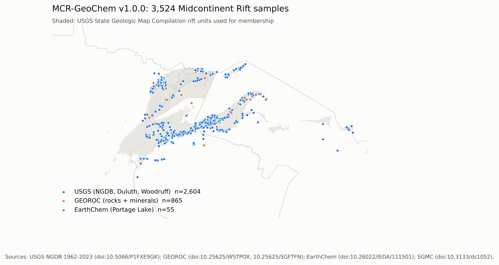

# MCR-GeoChem: harmonized geochemistry of the Midcontinent Rift (Michigan, Minnesota, Wisconsin)

**Status:** Released v1.0.0 (2026-10-19) | **Maintainer:** Bezali Kwame Danso ([ORCID](https://orcid.org/0009-0006-1201-4129)) | **License:** data CC BY-SA 4.0, code MIT, docs CC BY 4.0

**In plain terms:** The 1.1-billion-year-old Midcontinent Rift around Lake Superior hosts nickel, copper, cobalt, and platinum-group metals, all on the 2025 U.S. critical minerals list. The rock chemistry needed to study them is scattered across federal and international databases that use different units, lab methods, and ways of writing "too small to measure." MCR-GeoChem puts 3,524 rift samples from Michigan, Minnesota, and Wisconsin into one documented, quality-flagged table, and ships the method crosswalk and the QA checker that made it.

**Authors:** Bezali Kwame Danso ([ORCID](https://orcid.org/0009-0006-1201-4129)), Independent Researcher, East Lansing, Michigan, USA; Saadatu Abdullah, Independent Researcher, Athens, Georgia, USA

New here? Read [docs/START_HERE.md](docs/START_HERE.md) first. Terms are explained in [docs/GLOSSARY.md](docs/GLOSSARY.md).

MCR-GeoChem v1.0.0 merges the USGS National Geochemical Database 1962-2023 release, two USGS Duluth Complex data releases, GEOROC 2.0 precompiled rock and mineral compilations, and an EarthChem Library dataset into a long table of 168,748 determinations (88 analytes) with consistent units (oxides wt%, traces ppm, Au and PGE ppb), decoded below- and above-limit values, a best value per sample and analyte, an analytical-method crosswalk covering 89 method codes, a detection-limit table, rift-membership labels tied to the USGS State Geologic Map Compilation, and sample- and value-level QA flags from the bundled `mcrqa` checker. It is built for USGS Midcontinent Rift and Earth MRI work, state surveys, universities, and explorers who need an open, citable starting table.



## What is here

```
code/            numbered scripts in run order (01_fetch ... 08_package)
mcrqa/           the QA checker package (pip-installable; tests in tests/)
data/raw/        provenance_log.csv (inputs are re-downloaded by 01_fetch.py)
data/processed/  samples, long and wide tables, method crosswalk, detection limits, QA report, stats.json
docs/            START_HERE, GLOSSARY, CODEBOOK, PROVENANCE, LIMITATIONS, QA_RULES, STATE_SOURCES, DECISIONS,
                 NEXT_STEPS, VERIFY_CHECKLIST, TALK_TRACK, PUBLISH_GUIDE, BUILD_SPEC, mcr_units.csv
paper/figures/   release figures
paper/preprint/  preprint (REVTeX source and PDF), built from the release tables by code/09_preprint.py
```

## Run it

```
pip install -r requirements.txt
./run_all.sh            # or run code/01_fetch.py ... code/08_package.py in order
```
Rebuilding takes 15 to 30 minutes, mostly the GEOROC mineral scan (about 2.4 million rows streamed and filtered). Expected result: `3,524 samples, 168,748 determinations` in `data/processed/qa_report.txt`, and 14 passing tests.

Check your own spreadsheet with the QA checker:
```
pip install .
mcrqa wide my_table.csv --id-col Sample --out qa_out/
```

## Sources

| ID | Source | Vintage | License | Kept samples |
|---|---|---|---|---:|
| S1 | USGS NGDB, Geochemical data for rock, sediment, soil, and mineral samples, United States and territories, 1962 to 2023 (Granitto et al.), [10.5066/P1FXE9GK](https://doi.org/10.5066/P1FXE9GK) | published Jan 2026 | Public domain | 2,237 |
| S2 | USGS, Geochemistry of drill core and hand samples from the Duluth Complex, Minnesota (Parks et al.), [10.5066/P13UFQYF](https://doi.org/10.5066/P13UFQYF) | 2025 | Public domain | 331 |
| S3 | USGS Earth MRI geochemistry, [10.5066/P9WHRLXH](https://doi.org/10.5066/P9WHRLXH) | v12.0, Dec 2025 | Public domain | 0 |
| S4 | GEOROC Compilation: Continental Flood Basalts, Midcontinent Rift System-Keweenawan, [10.25625/WSTPOX](https://doi.org/10.25625/WSTPOX) | generated 2026-09-01 | CC BY-SA 4.0 | 661 |
| S5 | GEOROC Compilation: Minerals (region-filtered), [10.25625/SGFTFN](https://doi.org/10.25625/SGFTFN) | 2024-12 | CC BY-SA 4.0 | 204 |
| S6 | EarthChem Library 1501, Portage Lake Volcanics (Davis, Collins & Rooney), [10.26022/IEDA/111501](https://doi.org/10.26022/IEDA/111501) | 2022 | CC BY-SA 4.0 | 55 |
| S7 | USGS, Duluth Complex basal contact watersheds, bedrock (Woodruff), [10.5066/P9VO251H](https://doi.org/10.5066/P9VO251H) | 2019 | Public domain | 36 |
| support | USGS SGMC ([10.3133/ds1052](https://doi.org/10.3133/ds1052)); USGS AGDB4 method tables ([10.5066/P14THGQH](https://doi.org/10.5066/P14THGQH)); Census TIGER 2023 states | | Public domain | |

Files, URLs, access dates, checksums, and row counts: [docs/PROVENANCE.md](docs/PROVENANCE.md). State survey releases are scheduled for v1.1 ([docs/STATE_SOURCES.md](docs/STATE_SOURCES.md)).

## Headline numbers (from `data/processed/stats.json`)

- 3,524 samples: 1,695 Minnesota, 1,057 Michigan, 772 Wisconsin; 3,076 rift igneous, 414 rift sedimentary, 34 post-rift sedimentary; 204 mineral analyses.
- 168,748 determinations; 26.3% of best values are below detection. 46,375 determinations (27%) are legacy semi-quantitative emission spectrography.
- Platinum: 579 of 1,304 samples have a measured value; 501 below-detection results have limits too high to be informative. Palladium: 648 of 1,304.
- 488 of 2,821 igneous whole-rock samples are flagged as likely altered; 239 samples in 110 groups are probable cross-source duplicates (flagged, not removed).

## Limitations

Read [docs/LIMITATIONS.md](docs/LIMITATIONS.md) before using or citing the data.

## Citation

See [CITATION.cff](CITATION.cff). Dataset DOI: 10.5281/zenodo.23501580. Method and detection-limit crosswalk: 10.5281/zenodo.23501707. mcrqa QA checker and pipeline: 10.5281/zenodo.23501711.

Cite the original sources too (table above). AI assistance (Claude) was used for code and documentation under the authors' direction; the authors made the analytic decisions and verified the outputs.
